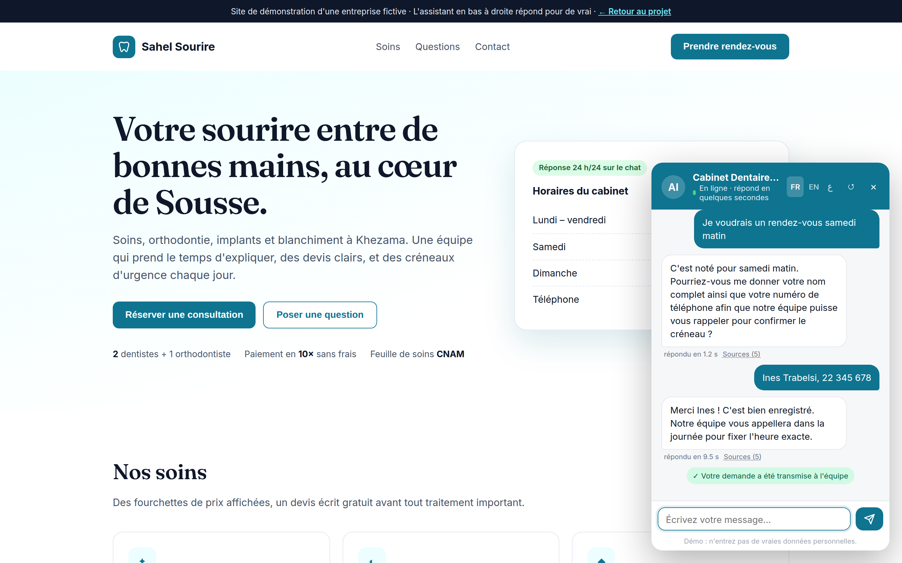
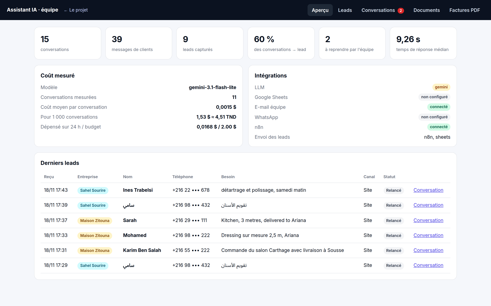
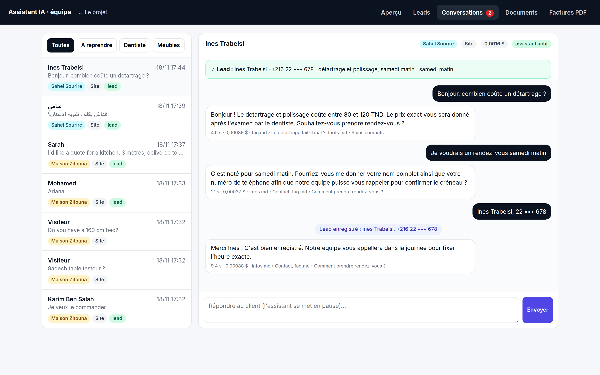
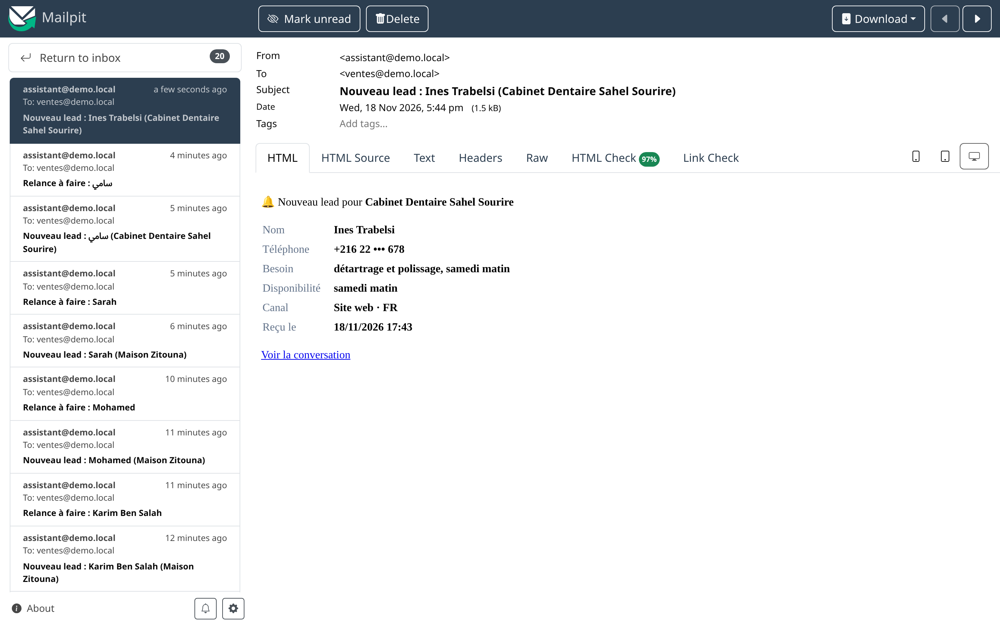
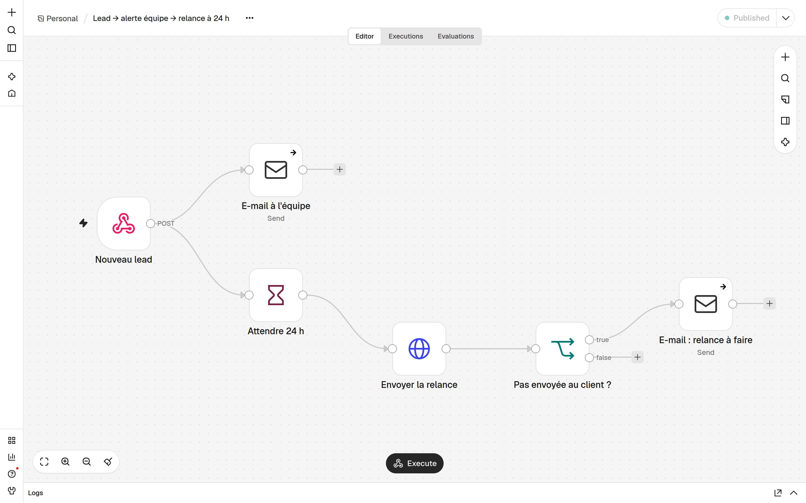
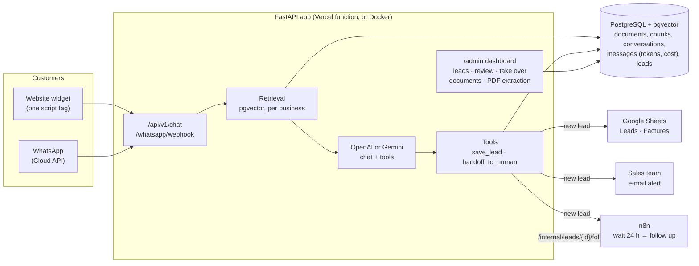

<div align="center">

# AI Customer Assistant

### Answers your customers 24/7 from your own documents, captures every lead and sends it to your team.

A chat widget for any website and a WhatsApp number that answer in French, English and Arabic (Tunisian<br/>
darija included) from the business's FAQ, price list and catalog. When a customer is interested, it<br/>
takes their name, phone and need, saves the lead to Google Sheets, e-mails the team, and an n8n<br/>
workflow follows up 24 hours later.

<br/>

[](https://ai-customer-assistant-demo.vercel.app/)
&nbsp;
[](https://ai-customer-assistant-demo.vercel.app/docs)
&nbsp;
[](https://github.com/MedAmine-SUDO/ai-customer-assistant/actions/workflows/ci.yml)


<br/>



</div>

<br/>

## Try it in 30 seconds

| | |
| --- | --- |
| 🦷 **Dental clinic, Sousse** | [/demo/dentiste](https://ai-customer-assistant-demo.vercel.app/demo/dentiste): ask *« Combien coûte un détartrage ? »*, then book an appointment |
| 🛋️ **Furniture shop** | [/demo/meubles](https://ai-customer-assistant-demo.vercel.app/demo/meubles): ask *« 9adech salon Carthage ? »* or for a made-to-measure kitchen quote |
| 📋 **Team dashboard** | [/admin](https://ai-customer-assistant-demo.vercel.app/admin), password `demo1234`: leads, conversations to take over, documents, invoice PDFs |
| 💬 **WhatsApp** | the same assistant on a WhatsApp number (links on the [demo page](https://ai-customer-assistant-demo.vercel.app/)) |
| 📖 **API** | [/docs](https://ai-customer-assistant-demo.vercel.app/docs) |

Both businesses are fictional. Visitors' conversations are deleted after 48 hours, and phone numbers are
masked on the public demo, but please use made-up details anyway.

<br/>

## ✨ What it does

- 💬 **Answers from your documents, not from the internet.** The FAQ, price list and catalog are split
  by heading, embedded and stored in PostgreSQL with **pgvector**. Each question pulls the closest
  passages and the model answers **only** from them: no invented prices, no made-up opening hours. Each
  answer keeps the passages it used, so you can check where it came from.
- 🌍 **French, English, Arabic and darija.** It answers in the customer's language, including Tunisian
  darija written in Arabic or Latin letters (*« 9adech »*, *« famma livraison ? »*). The widget switches
  to right-to-left for Arabic.
- 🎯 **Captures the lead at the right moment.** When someone wants an appointment, a quote or an order,
  it asks for the name, phone number and need (only what's missing, two things at a time). The phone is
  checked (8-digit Tunisian numbers, or international ones) and if it's wrong the assistant asks again.
- 📊 **Lead → Google Sheets → team.** The lead lands in a Google Sheet as a new row, and the sales team
  gets an e-mail alert with a link to the conversation. Each destination is independent: if Google is
  down, the lead is still in the database and the alert still goes out.
- ⏰ **The follow-up the next day, with n8n.** An n8n workflow waits 24 hours, then calls back the app:
  WhatsApp customers get the follow-up from the business number directly, in their language; for
  website leads the team gets an e-mail with a **one-click WhatsApp link** and the message already
  written.
- 🙋 **Hands over to a human.** A customer who asks for a person, complains, or has an emergency (tooth
  pain with swelling at the clinic) is passed to the team: they're alerted by e-mail, answer from the
  dashboard, and the customer sees the reply in the same chat. The bot stays quiet until they hand back.
- 📱 **On WhatsApp too.** The same assistant answers on the business's WhatsApp number (Cloud API). The
  demo's links prefill *« Bonjour Maison Zitouna »*, which picks the business; *menu* switches. It
  already has the customer's number, so it doesn't ask for it. WhatsApp allows free text only within
  24 hours of the customer's last message, so a later follow-up uses an approved template, or goes to
  the team by e-mail if there's none.
- 🧾 **Bonus: invoice and quote PDFs → rows.** Drop a supplier invoice in the dashboard: supplier,
  *matricule fiscal*, number, date, HT, TVA, timbre and TTC are extracted (structured output) into the
  sheet's « Factures » tab. Scanned PDFs work too, the model reads the page.
- 📚 **Documents you can update.** Upload a new price list (PDF, Markdown or text) from the dashboard:
  it's searchable from the next question.
- 💰 **Every answer's cost, measured.** Tokens and price are logged per answer, so the dashboard shows
  the real cost per conversation and per 1,000 conversations, in dollars and dinars.

<br/>

<table>
<tr>
<td width="50%"></td>
<td width="50%"></td>
</tr>
<tr>
<td align="center"><sub>The dashboard: leads, cost, integrations</sub></td>
<td align="center"><sub>Reviewing a conversation: sources, time and cost of each answer</sub></td>
</tr>
<tr>
<td width="50%"></td>
<td width="50%"></td>
</tr>
<tr>
<td align="center"><sub>The team's e-mail for a new lead (Mailpit locally)</sub></td>
<td align="center"><sub>The n8n workflow</sub></td>
</tr>
</table>

<br/>

## 💰 What it costs to run

Clients ask this first, so the app measures it: every answer stores the tokens it used and their price
(prices are settings in [`.env.example`](.env.example), to keep in line with
[OpenAI's](https://developers.openai.com/api/docs/pricing) or
[Google's](https://aistudio.google.com/docs/pricing) pricing). The live figure is on the
[demo page](https://ai-customer-assistant-demo.vercel.app/#cout) and in the dashboard.

| Measured on 18 Nov 2026 | |
| --- | --- |
| Model | `gemini-3.1-flash-lite` ($0.25 in / $1.50 out per 1M tokens on the paid tier), embeddings `gemini-embedding-2` |
| Benchmark | 8 conversations, 26 customer messages, French / darija / English |
| Cost per conversation | **$0.0016** at paid rates |
| **1,000 conversations** | **≈ $1.57 ≈ 4.6 TND** at paid rates. The demo itself runs on Gemini's free tier: $0 |

On the free tier the answer time depends on Google's load: the median was 2.7 s in one run and 9.8 s
in another, when half the requests found the main model overloaded and went to the backup one.

To measure it on your own instance, [`scripts/benchmark.py`](scripts/benchmark.py) plays eight realistic
conversations (French, darija, English; prices, delivery, a lead or a handoff each) and prints the
result:

```bash
uv run python scripts/benchmark.py http://localhost:8000 --rounds 3
```

What drives the bill: the documents sent with each question (5 passages), the conversation history (12
messages) and the answer length. The guards for a public deployment are settings too: messages per
conversation, conversations per visitor per day, and a **daily budget** after which the assistant
politely stops.

<br/>

## 🏗️ Architecture



**One message's life:** the question (plus the previous one, for follow-ups like *« et pour les
enfants ? »*) is embedded and matched against that business's passages only. The model gets them with
the rules and the conversation so far, and two tools. If it calls `save_lead`, the app validates the
phone and stores the lead, and the model either confirms or asks again. The answer, its sources,
tokens, cost and latency are logged; the Sheets row, e-mail alert and n8n call go out after the
customer has the reply.

```
app/
├── main.py              FastAPI app, pages, Swagger text
├── tenants.py           the two demo businesses (a new client = one entry + one folder)
├── models.py            documents, chunks (vector 1536), conversations, messages, leads, extracted PDFs
├── llm/                 openai_llm.py and a keyless mock with the same interface (tests, CI)
├── services/
│   ├── assistant.py     prompt, retrieval, tool loop, logging, limits
│   ├── knowledge.py     chunking by heading, embeddings, vector search
│   ├── leads.py         phone validation, Sheets / e-mail / n8n, the follow-up
│   ├── extract.py       invoice and quote PDFs → structured rows
│   ├── sheets.py        Google Sheets with a service account (no Google SDK)
│   ├── whatsapp.py      WhatsApp Cloud API: text, buttons, templates, signature check
│   ├── mailer.py        team e-mails over SMTP
│   └── costs.py         cost per answer, per conversation, per 1,000
├── api/routes/          chat, whatsapp_bot, admin, internal (n8n and the daily schedule)
└── seed.py              embeds the documents, adds example conversations, daily reset
knowledge/               the businesses' own documents, in Markdown
frontend/                widget.js, the two demo websites, the hub, the dashboard (no build step)
n8n/                     the workflow, ready to import, and Mailpit's SMTP credential
samples/                 three fictional supplier invoices and quotes to try the extraction
tests/                   67 tests on PostgreSQL + pgvector, with the mock LLM
```

<br/>

## 🚀 Run it

**With Docker** (the only requirement):

```bash
git clone https://github.com/MedAmine-SUDO/ai-customer-assistant.git
cd ai-customer-assistant
cp .env.example .env          # set LLM_PROVIDER=gemini + GEMINI_API_KEY (free) or openai, or keep the mock
docker compose up
```

- http://localhost:8000: the demo page, the two websites and `/admin` (password `demo1234`)
- http://localhost:8025: Mailpit, a local inbox that catches every e-mail to the team
- http://localhost:5678: n8n. Import the SMTP credential (pointing at Mailpit) and the workflow, then
  publish it:

  ```bash
  docker compose exec n8n n8n import:credentials --input=/workflows/smtp-mailpit.json
  docker compose exec n8n n8n import:workflow --input=/workflows/lead-followup.json
  docker compose exec n8n n8n list:workflow            # copy the id
  docker compose exec n8n n8n publish:workflow --id=<id>
  docker compose restart n8n
  ```

  Set `FOLLOWUP_DELAY_MINUTES=2` in `.env` to see the follow-up without waiting a day.

Without an API key, the app runs on a built-in mock (simple keyword search and scripted answers): good
enough to click around and to run the tests, not to judge the answers.

**For development** (with [uv](https://docs.astral.sh/uv/)):

```bash
uv sync
docker compose up -d db                 # PostgreSQL with pgvector
uv run alembic upgrade head
uv run python -m app.seed               # embed the documents, add example conversations
uv run uvicorn app.main:app --reload
uv run pytest                           # needs TEST_DATABASE_URL pointing at a pgvector database
```

### Connect Google Sheets, e-mail, WhatsApp and n8n

<details>
<summary><b>Google Sheets</b> (5 minutes)</summary>

1. In [Google Cloud Console](https://console.cloud.google.com): create a project, enable the **Google
   Sheets API**, then **IAM → Service accounts → Create**, and under **Keys** add a JSON key.
2. Create a Google Sheet and **share** it (editor) with the service account's e-mail.
3. Set `GOOGLE_SHEET_ID` (the long id in the sheet's URL) and `GOOGLE_SERVICE_ACCOUNT_JSON` (the key
   file's content, raw or base64). The « Leads » and « Factures » tabs and their headers are created on
   the first write.
4. Optional, for a demo: share the sheet as *view only* by link and put that link in `PUBLIC_SHEET_URL`.

</details>

<details>
<summary><b>E-mail</b> (team alerts)</summary>

Any SMTP server works. With Gmail: turn on 2-step verification, create an
[app password](https://myaccount.google.com/apppasswords), then set `SMTP_HOST=smtp.gmail.com`,
`SMTP_PORT=587`, `SMTP_USERNAME` (your address), `SMTP_PASSWORD` (the app password) and `TEAM_EMAIL`
(one address or several, comma-separated). With `docker compose`, e-mails go to Mailpit unless you set
these.

</details>

<details>
<summary><b>WhatsApp</b> (Cloud API, free test number)</summary>

1. On [developers.facebook.com](https://developers.facebook.com): **Create app → Business**, add
   **WhatsApp**. **API Setup** gives a free test number, its `WHATSAPP_PHONE_NUMBER_ID` and a temporary
   access token; add up to 5 phones allowed to message it. For a token that doesn't expire, create a
   system user in Business Settings and give it `whatsapp_business_messaging`.
2. Set `WHATSAPP_ACCESS_TOKEN`, `WHATSAPP_PHONE_NUMBER_ID`, `WHATSAPP_APP_SECRET` (**App settings →
   Basic**), any random `WHATSAPP_VERIFY_TOKEN`, and `WHATSAPP_DISPLAY_NUMBER` for the demo page's links.
3. **WhatsApp → Configuration → Webhook:** URL `https://your-host/whatsapp/webhook`, the same verify
   token, then subscribe to **messages**. The app checks Meta's signature on every call.
4. Optional: create a *utility* template such as *« Bonjour {{1}}, ici {{2}}. Suite à votre demande
   d'hier, souhaitez-vous qu'on en parle ? »* and set `WHATSAPP_FOLLOWUP_TEMPLATE` to its name. It's
   used for follow-ups once the 24-hour window has closed.

</details>

<details>
<summary><b>n8n</b></summary>

`docker compose up` starts n8n next to the app and sets `LEAD_SINKS=sheets,n8n`, so the app sends each
new lead to the workflow's webhook. The workflow e-mails the team, waits, calls
`/internal/leads/{id}/followup` with `INTERNAL_SECRET`, and when the app couldn't reach the customer on
WhatsApp, e-mails the team the follow-up with its WhatsApp link. For a real mailbox, edit the
« SMTP équipe » credential in n8n.

Without n8n (the live demo on Vercel), use `LEAD_SINKS=sheets,email`: the app e-mails the team itself,
and the daily schedule sends the follow-ups that are due.

</details>

### Deploy on Vercel + Neon (free)

1. **Vercel → Add New → Project**, import this repo. FastAPI is detected.
2. **Storage → Create → Neon** and connect it: this sets `DATABASE_URL`. pgvector is available on Neon;
   the first migration enables it.
3. **Environment variables:** `ENVIRONMENT=production`, `SECRET_KEY`, `CRON_SECRET`,
   `LLM_PROVIDER`, `OPENAI_API_KEY` or `GEMINI_API_KEY` (and the Gemini models), `ADMIN_PASSWORD`, plus the
   Sheets, SMTP and WhatsApp ones.
4. **GitHub → Settings → Secrets → Actions:** `NEON_DATABASE_URL_UNPOOLED` and `OPENAI_API_KEY` (or
   `GEMINI_API_KEY`, with the variables `LLM_PROVIDER=gemini` and `EMBEDDING_MODEL=gemini-embedding-2`). On
   every push to `main`, CI applies the migrations and embeds the documents.
5. [`vercel.json`](vercel.json) schedules `/internal/reset-demo` daily at 11:00 Tunis time: visitors'
   data older than 48 hours is deleted and the follow-ups that are due go out.

<br/>

## 🐛 Found by running it on a real model

The mock LLM passed every test; these only showed up against Gemini's real API.

| What happened | Why | Fix |
| --- | --- | --- |
| Every lead failed with a 400 after the customer gave their details | Gemini 3 attaches a `thought_signature` to each tool call and rejects the follow-up without it | Tool calls keep the provider's extra fields and send them back ([test](tests/test_chat.py)) |
| Seeding crashed on the embeddings | Gemini's OpenAI-compatible endpoint leaves `index` empty on each vector | Sort by index only when every result has one |
| The app didn't start with an OpenAI account that had no credit | `set -e` in the entrypoint: a failed seed stopped the server | The seed logs a warning and the app starts |
| Half the answers took 20–50 s at busy hours | The free model answered 503 « high demand », then the client retried it | No retry on the main model when a backup is set: straight to `gemini-3.5-flash-lite` |
| « 9adech salon ? » got a French answer, Arabic darija got standard Arabic | The prompt's rule wasn't enough for a Lite model | Darija is detected (both scripts) and the model is told explicitly, per message |
| An English quote request got a French answer, and « Sarah, 29 000 111 » switched back to French | Too few English words in the detector; a message with no clue defaulted to French | More words, and a message with no clue keeps the conversation's language |
| The assistant asked for an e-mail address | The strict tool schema lists `email` as required (nullable), and the model read it as needed | Field descriptions and the prompt say never to ask for it |
| Search kept unrelated passages | Gemini's embeddings sit closer together than OpenAI's: unrelated questions scored 0.44–0.48, real ones 0.20–0.38 | `RETRIEVAL_MAX_DISTANCE=0.42` for Gemini (0.75 for OpenAI) |

<br/>

## ✅ Production habits

| | |
| --- | --- |
| 🧪 **Tests** | 67 pytest tests on PostgreSQL + pgvector: retrieval scoped per business, lead capture and correction, phone validation, handoff and takeover, each lead destination, the n8n payload and callback (and its retry), signed WhatsApp webhooks and the 24-hour window, PDF extraction, limits, demo reset, masking, language detection, provider fallback |
| 🤖 **No key in CI** | A mock LLM with the same interface (hashed embeddings, scripted tool calls) makes the tests deterministic and free |
| 🔁 **CI** | GitHub Actions: lint, migrations up / `alembic check` / down, tests, `docker compose` smoke test, then migrations and embeddings on the production database |
| 🛡️ **Public demo safety** | Message and conversation caps, a daily budget, IPs stored only as a daily salted hash, phone numbers masked, 48-hour retention |
| 🔐 **Webhooks** | Meta's HMAC signature is checked on every WhatsApp call, and duplicate deliveries are answered once; n8n and the schedule use a bearer secret |
| 🐳 **Container** | Slim image, non-root user, health check, migrations on start; a failed seed doesn't stop it |
| 🔌 **Provider down** | Rate limits and overloads get a polite « try again in a minute » in the customer's language, after one try on a backup model (`FALLBACK_MODEL`) |

<br/>

## 🔧 Adapt it to a business

| You want… | Change |
| --- | --- |
| Your own business | One entry in [`app/tenants.py`](app/tenants.py) (name, tone, what a lead needs, follow-up text) and your documents in `knowledge/<name>/` |
| The widget on your site | `<script src="https://your-host/widget.js" data-tenant="name" data-color="#0e7490" defer></script>` |
| A CRM instead of a sheet | One more destination next to `sheets`/`email`/`n8n` in [`leads.py`](app/services/leads.py), or plug the CRM node into the n8n workflow |
| Messenger or Instagram | The same `handle_message()` behind Meta's webhook, like [`whatsapp_bot.py`](app/api/routes/whatsapp_bot.py) |
| Another model or provider | `LLM_PROVIDER=openai` or `gemini` and `CHAT_MODEL`, or `OPENAI_BASE_URL` for any OpenAI-compatible API |

<br/>

## 🗺️ Roadmap

- [x] RAG answers in French, English and darija, lead capture, handoff, PDF extraction
- [x] n8n workflow: team e-mail, 24-hour follow-up, WhatsApp link
- [x] OpenAI or Gemini, with cost measured per answer
- [ ] WhatsApp number live on the demo (Meta test number)
- [ ] Google Sheet connected on the live demo
- [x] Live demo on Vercel + Neon (Frankfurt)
- [ ] 60-second video: question → lead in the sheet → team alerted

<br/>

---

<sub>🇫🇷 **Assistant IA pour entreprise : réponses automatiques 24/7 + capture de leads vers Google
Sheets (OpenAI / Gemini, n8n).** Un chat pour votre site et un numéro WhatsApp qui répondent à vos clients en
français, en anglais et en arabe (darija comprise) à partir de vos documents (FAQ, tarifs, catalogue),
demandent le nom et le téléphone des clients intéressés, enregistrent le lead dans Google Sheets,
préviennent l'équipe et relancent le client le lendemain avec n8n. Transfert à un humain en cas de
doute, conversations journalisées, extraction des factures PDF, et coût mesuré par conversation.</sub>

<div align="center">

Made with ☕ by [MedAmine-SUDO](https://github.com/MedAmine-SUDO)

</div>
